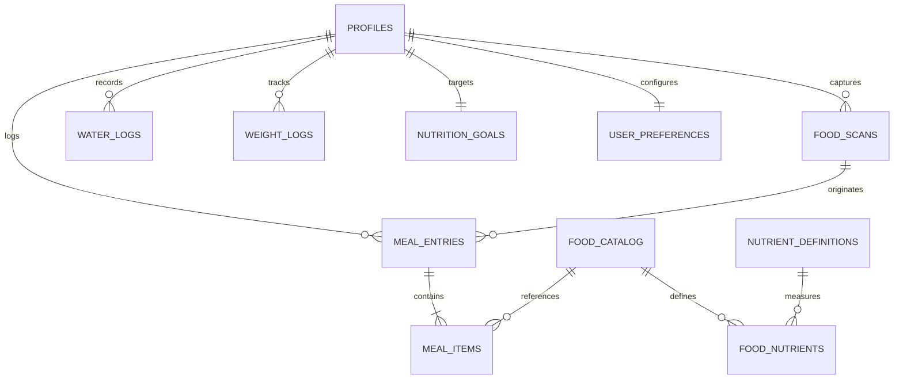

# FITTRACK AI — Database Schema Documentation

FITTRACK AI utilizes PostgreSQL / Supabase with Row Level Security (RLS) enabled across user tables, with SQLite async fallback for local zero-config runs.

---

## 1. Entity Relationship Diagram (ERD)



---

## 2. Table Specifications

### 2.1 `profiles`
Primary identity record linked to authentication.
- `id` (UUID, Primary Key)
- `email` (TEXT, Unique, Indexed)
- `full_name` (TEXT)
- `avatar_url` (TEXT)
- `created_at`, `updated_at` (TIMESTAMPTZ)

### 2.2 `nutrition_goals`
Evidence-based dietary targets.
- `id` (UUID, Primary Key)
- `user_id` (UUID, Foreign Key -> `profiles.id`, Indexed)
- `daily_calorie_target` (FLOAT, Default: 2100.0)
- `daily_protein_target_g` (FLOAT, Default: 130.0)
- `daily_carbs_target_g` (FLOAT, Default: 230.0)
- `daily_fat_target_g` (FLOAT, Default: 65.0)
- `daily_water_target_ml` (FLOAT, Default: 2500.0)
- `target_weight_kg` (FLOAT)

### 2.3 `food_catalog`
Composite database of USDA FoodData Central and Indian Food Composition Tables (IFCT).
- `id` (TEXT, Primary Key)
- `name` (TEXT, Indexed)
- `category` (TEXT)
- `default_serving_unit` (TEXT)
- `default_serving_weight_g` (FLOAT)
- `is_verified` (BOOLEAN, Default: TRUE)
- `data_source` (TEXT) — e.g. "IFCT_2017", "USDA_FDC"

### 2.4 `food_nutrients`
Nutrient values per 100g of food.
- `id` (UUID, Primary Key)
- `food_id` (TEXT, Foreign Key -> `food_catalog.id`)
- `nutrient_code` (TEXT, Foreign Key -> `nutrient_definitions.code`)
- `amount_per_100g` (FLOAT)

### 2.5 `food_scans`
Audited multimodal camera image captures.
- `id` (UUID, Primary Key)
- `user_id` (UUID, Foreign Key -> `profiles.id`, Indexed)
- `image_path` (TEXT)
- `model_name` (TEXT) — e.g. "gemini-1.5-flash"
- `overall_confidence` (FLOAT)
- `raw_response_json` (TEXT / JSONB)
- `created_at` (TIMESTAMPTZ)

### 2.6 `meal_entries`
Logged meals grouped by type and date.
- `id` (UUID, Primary Key)
- `user_id` (UUID, Foreign Key -> `profiles.id`, Indexed)
- `scan_id` (UUID, Foreign Key -> `food_scans.id`, Nullable)
- `meal_type` (TEXT) — "breakfast", "lunch", "dinner", "snack"
- `meal_title` (TEXT)
- `logged_date` (DATE, Indexed)
- `logged_at` (TIMESTAMPTZ)
- `total_calories`, `total_protein_g`, `total_carbs_g`, `total_fat_g`, `total_fiber_g` (FLOAT)

### 2.7 `meal_items`
Itemized plate foods with exact portion weights.
- `id` (UUID, Primary Key)
- `meal_id` (UUID, Foreign Key -> `meal_entries.id` ON DELETE CASCADE)
- `food_id` (TEXT, Foreign Key -> `food_catalog.id`)
- `name` (TEXT)
- `serving_unit` (TEXT)
- `serving_weight_g` (FLOAT)
- `quantity` (FLOAT)
- `calories`, `protein_g`, `carbs_g`, `fat_g`, `fiber_g` (FLOAT)
- `cooking_method` (TEXT) — "raw", "boiled", "steamed", "shallow_fried", "deep_fried"
- `oil_adjustment` (TEXT) — "low", "normal", "high"

### 2.8 `water_logs` & `weight_logs`
Hydration and weight tracking.
- `water_logs`: `user_id`, `amount_ml`, `logged_date`, `logged_at`
- `weight_logs`: `user_id`, `weight_kg`, `logged_date`, `logged_at`

---

## 3. Row-Level Security (RLS)

All user tables (`profiles`, `nutrition_goals`, `meal_entries`, `meal_items`, `food_scans`, `water_logs`, `weight_logs`) enforce RLS:
```sql
CREATE POLICY "Users can only view their own meals"
ON meal_entries FOR SELECT
USING (auth.uid() = user_id);

CREATE POLICY "Users can only insert their own meals"
ON meal_entries FOR INSERT
WITH CHECK (auth.uid() = user_id);
```
Food catalogs and nutrient definitions are globally readable but write-restricted to administrators.
